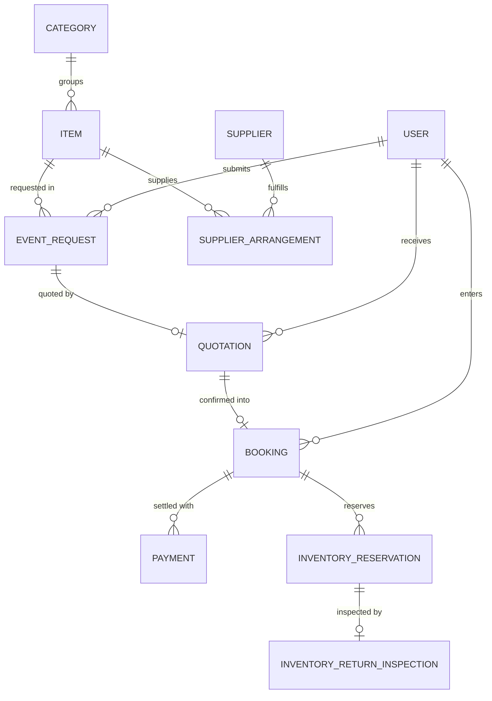

# Patel Ji Tent House — Synthetic Dataset Data Dictionary

This document details the schema, column definitions, data types, and analytical utility of the synthetic datasets generated for the **Patel Ji Tent House** event rental platform.

All datasets are exported in standard RFC-4180 CSV format inside `server/synthetic/exports/` and can be loaded directly into Python (Pandas/Polars), Jupyter Notebooks, Microsoft Power BI, Tableau, or SQL engines.

---

## 1. Customers (`customers.csv`)
- **Total Records:** 1,500
- **Primary Key:** `_id` / `syntheticId`
- **Description:** Registered customer accounts in Rajasthan for event rentals.

| Column | Data Type | Description & Domain Rules |
|---|---|---|
| `syntheticId` | String | Unique synthetic identifier (format: `CUST-SYN-00001` to `CUST-SYN-01500`). |
| `_id` | ObjectId | MongoDB BSON 24-character hexadecimal ObjectId. |
| `name` | String | Full name using authentic Indian names (e.g. "Aarav Sharma", "Pooja Patel"). |
| `phone` | String | Fictitious non-dialable test format `+91-000-000-XXXX` (DoT Level-0 unassigned). |
| `email` | String | Synthetic RFC 2606 test domain email (`synthetic.*@pateltenthouse.test`). |
| `role` | String | User role enum: `customer`. |
| `status` | String | User status enum: `active`. |
| `createdAt` | ISO DateTime | Account registration timestamp reflecting seasonal distribution (2025–2026). |

### Analytical Use Cases:
- Customer Lifetime Value (CLV) calculation.
- Customer segmentation (RFM: Recency, Frequency, Monetary).
- Repeat booking rate analysis.

---

## 2. Inventory Items (`inventory_items.csv`)
- **Total Records:** 300
- **Primary Key:** `_id` / `itemCode`
- **Foreign Key:** `categorySlug` -> `Category`
- **Description:** Rental equipment catalogue spanning 8 tent-house categories.

| Column | Data Type | Description & Domain Rules |
|---|---|---|
| `syntheticId` | String | Synthetic identifier (format: `ITEM-SYN-0001` to `ITEM-SYN-0300`). |
| `_id` | ObjectId | MongoDB BSON ObjectId. |
| `itemCode` | String | Human-readable item inventory SKU code. |
| `name` | String | Authentic commercial rental item name (e.g. "Royal Waterproof Shamiana Tent - Imperial Series"). |
| `categorySlug` | String | Category slug (`tents`, `furniture`, `lighting`, `decoration`, `stage`, `catering`, `sound-systems`, `utilities`). |
| `categoryName` | String | Human-readable category title. |
| `basePrice` | Integer (INR) | Rental rate in Indian Rupees (₹50 to ₹1,50,000 depending on item grade). |
| `priceUnit` | String | Pricing unit enum (`Per Piece`, `Per Day`, `Per Unit`, `Per Setup`). |
| `ownStock` | Integer | Owned physical equipment stock count in warehouse (5 to 1,200 units). |
| `status` | String | Item rental status: `active`. |

### Analytical Use Cases:
- Inventory capital allocation and utilization rate modeling.
- Category-wise revenue contribution (Pareto 80/20 analysis).
- Stock shortage and buffer stock threshold determination.

---

## 3. Event Requests (`event_requests.csv`)
- **Total Records:** 3,000
- **Primary Key:** `_id` / `requestId`
- **Foreign Key:** `user` -> `customers._id`
- **Description:** Initial event requirements submitted by customers.

| Column | Data Type | Description & Domain Rules |
|---|---|---|
| `syntheticId` | String | Synthetic identifier (format: `REQ-SYN-000001` to `REQ-SYN-003000`). |
| `_id` | ObjectId | MongoDB BSON ObjectId. |
| `requestId` | String | Human-readable request reference (format: `PJTH-SYN-000001`). |
| `user` | ObjectId | Foreign key referencing `customers._id`. |
| `eventType` | String | Event classification enum (`Wedding`, `Engagement`, `Birthday`, `Reception`, `Corporate`, `Religious`, `Other`). |
| `startDate` | ISO DateTime | Scheduled event commencement date. |
| `endDate` | ISO DateTime | Scheduled event conclusion date (`endDate >= startDate`). |
| `location` | String | Jaipur locality (e.g. "Mansarovar, Jaipur", "Diggi Palace Area, Jaipur"). |
| `guestCount` | Integer | Anticipated attendee count (30 to 1,500). |
| `status` | String | Request lifecycle status enum (`Submitted`, `Under Review`, `Quotation Draft`, `Quotation Sent`, `Quotation Accepted`, `Quotation Expired`, `Rejected`, `Cancelled`). |
| `estimatedAmount` | Integer (INR) | Estimated requirement value calculated from requested items. |
| `createdAt` | ISO DateTime | Request submission timestamp (14 to 90 days before `startDate`). |

### Analytical Use Cases:
- Demand forecasting using seasonal moving averages and time-series models (ARIMA, Prophet).
- Lead time distribution analysis (days in advance vs event scale).
- Venue and locality clustering across Jaipur.

---

## 4. Quotations (`quotations.csv`)
- **Total Records:** 2,500
- **Primary Key:** `_id` / `syntheticId`
- **Foreign Keys:** `request` -> `event_requests._id`, `customer` -> `customers._id`
- **Description:** Formal business proposals generated by admin for customer requirements.

| Column | Data Type | Description & Domain Rules |
|---|---|---|
| `syntheticId` | String | Synthetic identifier (format: `QUOT-SYN-000001` to `QUOT-SYN-002500`). |
| `_id` | ObjectId | MongoDB BSON ObjectId. |
| `request` | ObjectId | Foreign key referencing `event_requests._id`. |
| `customer` | ObjectId | Foreign key referencing `customers._id`. |
| `eventType` | String | Event category matching the parent request. |
| `decorationServices` | Integer (INR) | Value-added mandap/floral decor charges (₹2,000 to ₹25,000). |
| `transportation` | Integer (INR) | Logistics and carriage charges across Jaipur (₹1,500 to ₹8,000). |
| `discount` | Integer (INR) | Volume or goodwill concession (0% to 10% of items total). |
| `additionalCharges` | Integer (INR) | Generator diesel, rigging, or night surcharge (₹0 to ₹4,000). |
| `finalTotal` | Integer (INR) | Net quotation value (`itemsTotal + decorationServices + transportation + additionalCharges - discount`). |
| `status` | String | Quotation outcome enum (`Draft`, `Sent`, `Accepted`, `Rejected`, `Expired`). |
| `validityDate` | ISO DateTime | Quote expiration date (typically 14 days from quote creation). |
| `createdAt` | ISO DateTime | Quote generation timestamp (1 to 4 days after request creation). |

### Analytical Use Cases:
- Funnel conversion analysis (Request -> Quote Sent -> Accepted).
- Pricing sensitivity and discount elasticity modeling.
- Average Order Value (AOV) across event categories.

---

## 5. Bookings (`bookings.csv`)
- **Total Records:** 1,500
- **Primary Key:** `_id` / `bookingId`
- **Foreign Keys:** `request` -> `event_requests._id`, `quotation` -> `quotations._id`, `customer` -> `customers._id`
- **Description:** Legally binding rental bookings converted from accepted quotations.

| Column | Data Type | Description & Domain Rules |
|---|---|---|
| `syntheticId` | String | Synthetic identifier (format: `BOOK-SYN-000001` to `BOOK-SYN-001500`). |
| `_id` | ObjectId | MongoDB BSON ObjectId. |
| `bookingId` | String | Unique commercial booking ID (format: `PJTHB-SYN-000001`). |
| `customer` | ObjectId | Foreign key referencing `customers._id`. |
| `request` | ObjectId | Foreign key referencing `event_requests._id` (unique 1:1 relationship). |
| `quotation` | ObjectId | Foreign key referencing accepted `quotations._id`. |
| `location` | String | Confirmed venue address in Jaipur. |
| `startDate` | ISO DateTime | Event delivery start date. |
| `endDate` | ISO DateTime | Event retrieval end date. |
| `finalAmount` | Integer (INR) | Total contracted booking value (strictly equal to `quotations.finalTotal`). |
| `inventoryVerificationStatus` | String | Inventory verification state (`Verified`, `UnverifiedLegacy`). |
| `status` | String | Booking operational status enum (`Pending`, `Confirmed`, `Completed`, `Cancelled`). |
| `createdAt` | ISO DateTime | Booking confirmation timestamp. |

### Analytical Use Cases:
- Booking cancellation rate and lead time correlation.
- Peak season utilization vs off-season trough analysis.
- Billed revenue vs actual collected revenue reconciliation.

---

## 6. Payments (`payments_synthetic.csv`)
- **Total Records:** 2,000
- **Primary Key:** `paymentId`
- **Foreign Keys:** `bookingId` -> `bookings.bookingId`, `customerRef` -> `customers._id`
- **Description:** Reconciled financial transaction records (advances and final settlements).

| Column | Data Type | Description & Domain Rules |
|---|---|---|
| `paymentId` | String | Unique payment transaction ID (format: `PAY-SYN-000001` to `PAY-SYN-002000`). |
| `bookingId` | String | Foreign key referencing `bookings.bookingId`. |
| `bookingRef` | ObjectId | Foreign key referencing `bookings._id`. |
| `customerRef` | ObjectId | Foreign key referencing `customers._id`. |
| `amount` | Integer (INR) | Transacted cash amount in Indian Rupees. |
| `currency` | String | Currency code: `INR`. |
| `paymentType` | String | Payment milestone enum (`Advance`, `FinalSettlement`, `Milestone`, `Refund`). |
| `paymentMethod` | String | Payment instrument enum (`UPI`, `NEFT`, `NetBanking`, `Cheque`, `Cash`). |
| `transactionReference` | String | Fictitious bank/gateway reference (e.g. `UPI/SYN/1042/891241`). |
| `paymentDate` | ISO DateTime | Timestamp when money was realized. |
| `status` | String | Payment status: `Successful`. |

### Analytical Use Cases:
- Cash flow forecasting and daily collection velocity.
- Payment method distribution in Indian Tier-2 rental market (UPI vs NEFT vs Cash).
- Outstanding accounts receivable aging analysis.

---

## 7. Suppliers (`suppliers.csv`)
- **Total Records:** 100
- **Primary Key:** `_id` / `syntheticId`
- **Description:** External third-party vendors for sub-rental fulfillment.

| Column | Data Type | Description & Domain Rules |
|---|---|---|
| `syntheticId` | String | Synthetic identifier (format: `SUPP-SYN-0001` to `SUPP-SYN-0100`). |
| `_id` | ObjectId | MongoDB BSON ObjectId. |
| `name` | String | Vendor trading business name. |
| `phone` | String | Fictitious non-dialable test format (`+91-000-001-XXXX`). |
| `email` | String | Vendor contact email. |
| `address` | String | Workshop / warehouse address in Jaipur. |
| `categories` | String (Semicolon) | Category specialties provided by this vendor. |
| `status` | String | Vendor active status (`active`, `inactive`). |
| `createdAt` | ISO DateTime | Vendor onboarding date. |

---

## 8. Inventory Reservations (`inventory_reservations.csv`)
- **Total Records:** 2,500
- **Primary Key:** `_id` / `syntheticId`
- **Foreign Keys:** `booking` -> `bookings._id`, `item` -> `inventory_items._id`
- **Description:** Equipment stock allocation records for specific event dates.

| Column | Data Type | Description & Domain Rules |
|---|---|---|
| `syntheticId` | String | Synthetic identifier (format: `RES-SYN-00001` to `RES-SYN-02500`). |
| `_id` | ObjectId | MongoDB BSON ObjectId. |
| `booking` | ObjectId | Foreign key referencing `bookings._id`. |
| `item` | ObjectId | Foreign key referencing `inventory_items._id`. |
| `quantity` | Integer | Number of units reserved for the event window. |
| `source` | String | Stock provenance enum (`Owned`, `Supplier`). |
| `allocationIdempotencyKey` | String | Unique idempotency key preventing double-booking. |
| `status` | String | Reservation state: `Reserved`. |
| `verificationStatus` | String | Operational verification state: `Verified`. |
| `createdAt` | ISO DateTime | Reservation creation timestamp. |

---

## 9. Supplier Arrangements (`supplier_arrangements.csv`)
- **Total Records:** 1,500
- **Primary Key:** `_id` / `syntheticId`
- **Foreign Keys:** `booking` -> `bookings._id`, `supplier` -> `suppliers._id`, `item` -> `inventory_items._id`
- **Description:** Sub-contract commitments with external suppliers for peak season shortages.

| Column | Data Type | Description & Domain Rules |
|---|---|---|
| `syntheticId` | String | Synthetic identifier (format: `ARR-SYN-00001` to `ARR-SYN-01500`). |
| `_id` | ObjectId | MongoDB BSON ObjectId. |
| `request` | ObjectId | Foreign key referencing parent `event_requests._id`. |
| `supplier` | ObjectId | Foreign key referencing `suppliers._id`. |
| `booking` | ObjectId | Foreign key referencing `bookings._id`. |
| `item` | ObjectId | Foreign key referencing `inventory_items._id`. |
| `itemName` | String | Name of the sub-rented item. |
| `quantity` | Integer | Requested units from external vendor. |
| `confirmedQuantity` | Integer | Units confirmed by vendor (`confirmedQuantity <= quantity`). |
| `supplierCommitmentReference`| String | Vendor purchase order / booking reference (e.g. `PO-SYN-00042`). |
| `supplyStatus` | String | Supply state enum: `SupplierConfirmed`. |
| `allocationStatus` | String | Equipment status enum: `Reserved`. |
| `status` | String | Agreement status: `Confirmed`. |
| `createdAt` | ISO DateTime | Agreement confirmation timestamp. |

---

## 10. Inventory Return Inspections (`inventory_return_inspections.csv`)
- **Total Records:** 1,000
- **Primary Key:** `_id` / `syntheticId`
- **Foreign Keys:** `booking` -> `bookings._id`, `reservation` -> `inventory_reservations._id`
- **Description:** Post-event warehouse check-in inspection reports.

| Column | Data Type | Description & Domain Rules |
|---|---|---|
| `syntheticId` | String | Synthetic identifier (format: `INSP-SYN-00001` to `INSP-SYN-01000`). |
| `_id` | ObjectId | MongoDB BSON ObjectId. |
| `booking` | ObjectId | Foreign key referencing `bookings._id`. |
| `reservation` | ObjectId | Foreign key referencing `inventory_reservations._id`. |
| `item` | ObjectId | Foreign key referencing `inventory_items._id`. |
| `returnedQuantity` | Integer | Quantity returned from the event venue. |
| `inspectionOutcome` | String | Quality check outcome (`Passed`, `Damaged`, `NeedsRepair`, `Failed`). |
| `releaseStatus` | String | Stock release status (`Released`, `NotReleased`). |
| `releasedQuantity` | Integer | Quantity returned to available stock (0 if damaged; equals `returnedQuantity` if passed). |
| `releaseIdempotencyKey` | String | Unique idempotency key for released equipment. |
| `inspectedAt` | ISO DateTime | Inspection date (1 to 3 days after event conclusion). |

---

## Entity-Relationship Diagram (Relational Architecture)

